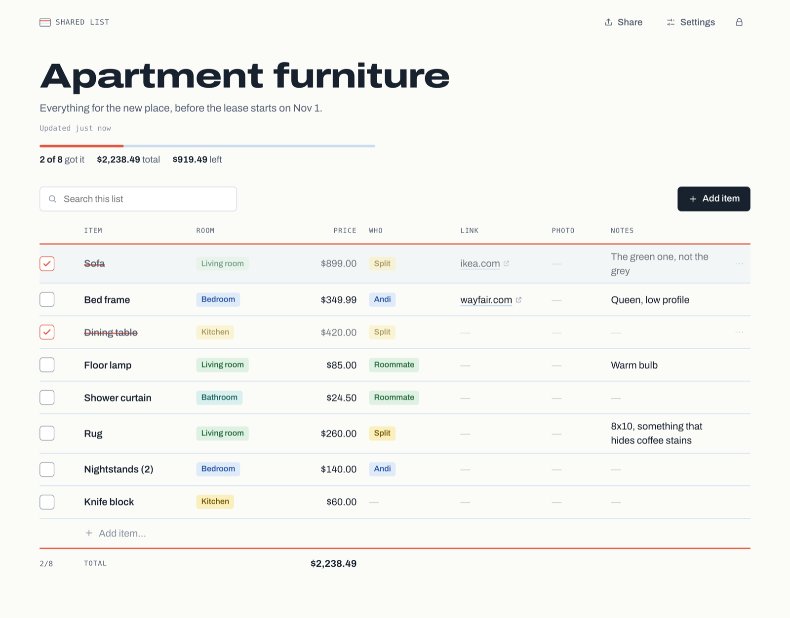
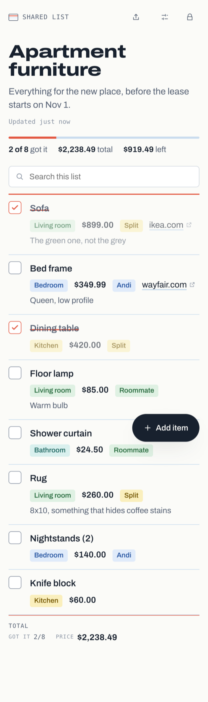
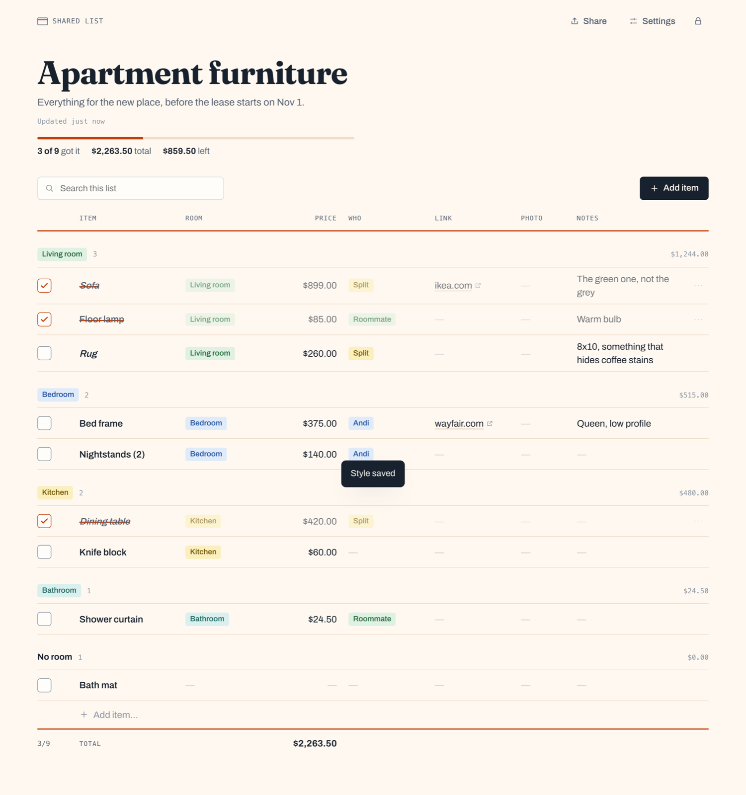

# Shared List

Lists you share as a link. Each one is locked with a password, works the same on
a phone and a laptop, and can carry its own CSS. An MCP server is built in, so an
AI agent can make the list, fill it in and restyle it for you.

Think of a small spreadsheet that is pleasant to look at: typed columns (text,
numbers, money, links, pictures, checkboxes, choices, dates), rows you tick off,
totals, grouping, search. It began as a furniture list for two roommates and is
built for anything you'd otherwise drop in a shared sheet.

<p>
  
  
</p>

Live at <https://reallyitsandi.com/shared-list/>.

## What it does

- **No accounts.** Press *Create list*, give it a title and a password, and send
  the link. Anyone with both can open it, edit it, change its password or delete
  it. The lock screen shows nothing about the list, not even its title. Sessions
  last 30 days per list and per device, and a new password signs everyone else
  out.
- **Edit together.** Tick rows, edit cells in place (click on a computer, tap
  on a phone), add rows, add and retype columns. Open tabs pick up each other's
  changes within a few seconds.
- **Typed columns.** Money columns total up, along with "how much is left" for
  rows that aren't ticked yet. Choice columns become colored tags and can group
  the rows. Links show their site; image links show a thumbnail. Columns can
  be narrow or wide, hidden from the table, and the list can have a default sort.
- **Pictures.** An image column takes a photo from your phone or computer
  (upload, paste or drag it in), a link to a picture, or a link to a shop page,
  which is swapped for that page's photo.
- **Paste a link, get the price.** A shop link fills in the row's price, photo
  and name from the page. Paste one straight into *Add item…* and that's the
  whole row. Add a Photo column later and it fills from the links already
  there. See [Link lookups](#link-lookups).
- **Per-list CSS.** Every list has a stylesheet that restyles its page for
  everyone. The default look is built on `--sl-*` variables and stable class
  names, so most themes are a few lines. See [Styling](#styling).
- **MCP.** Eighteen tools over Streamable HTTP. Agents can create, read, edit
  and restyle lists, lay out their columns, and look links up. Tokens can only
  be made by the server's operator. See [For agents](#for-agents).
- **Small.** One Node process and one SQLite file. No build step on the server,
  two runtime dependencies, about 50 MB of memory.

## For agents

The server speaks [MCP](https://modelcontextprotocol.io) at `<base>/mcp`,
statelessly. Each agent connects with its own token, sent as a bearer token.

### Tokens

Tokens are made on the server and nowhere else. No page and no API route can
mint one, so handing one out takes a shell on the box:

```sh
node server/cli.ts token create "Roommate"     # prints the token once
node server/cli.ts token list
node server/cli.ts token revoke Roommate        # by name or id
```

In Docker, prefix each one with `docker exec <container>`. Only a hash of each
token is stored.

A token sees the lists it created, plus any list it has opened with
`open_list` and that list's password. A token you give someone shows them none
of your other lists. Access through `open_list` ends when the list's password
changes, and only the token that created a list can make it view-only.

### Connecting

**Claude Code**

```sh
claude mcp add --transport http shared-list https://your.host/mcp \
  --header "Authorization: Bearer <token>"
```

**Any other client** that takes a JSON config:

```json
{
  "mcpServers": {
    "shared-list": {
      "type": "http",
      "url": "https://your.host/mcp",
      "headers": { "Authorization": "Bearer <token>" }
    }
  }
}
```

A client that can only be given a URL can put the token in the path instead:
`https://your.host/mcp/<token>`. That URL is a credential, so keep it
private, and remember that it ends up in the proxy's access log.

| Tool | What it does |
| --- | --- |
| `list_lists` | The token's lists: id, title, link, item count |
| `open_list` | Get access to someone else's list with its password |
| `get_list` | Columns, items (with ids) and view settings |
| `create_list` | A new list with a password, from columns or a preset, optionally with items and CSS |
| `update_list` | Title, description, grouping, default sort, password, edit access |
| `delete_list` | Delete a list |
| `add_columns` / `update_column` / `remove_column` | Change the columns: name, type, options, order, width, hidden, and what a link column fills. Retyping keeps the values that still fit |
| `add_items` / `update_items` / `remove_items` / `move_item` | Change the rows |
| `preview_link` | Read a shop page's name, photo and price without saving anything |
| `look_up_links` | Look the links in some rows up again and fill what is empty |
| `get_style_guide` | The class names and variables a list's CSS can use |
| `get_css` / `set_css` | Read or replace a list's CSS |

Agents refer to columns by name or id and send values the way people type them:
`"$1,299"` for money, `"yes"` for a checkbox, `ikea.com/p/123` for a link. A new
label in a choice column becomes a new option. A batch with one bad value adds
nothing, and the error says which column refused what.

Try asking: *"Make a shared list for our apartment furniture with item, room,
price, link and who's buying it, password couch123. Add a sofa, a bed frame and
a dining table. Then make it look warm and cozy."*

## Link lookups

When a link lands in a link column, the server reads the page in the background.
It fills the row's price, photo and name, but only cells that are empty. Nothing
anyone typed is overwritten, and a price in a different currency from the
column's is kept with the row rather than filled in. The row shows *Looking up…*
while it works, and the item's form says what was found, or why nothing was.

It reads, in order of trust:

1. schema.org `Product` data (JSON-LD), which most shop platforms publish,
2. Open Graph and `product:price` meta tags,
3. microdata (`itemprop="price"`),

and Amazon's own markup, which has none of those for its price. Temu, Amazon
and Shopify stores work. Some big retailers (IKEA, Walmart, Home Depot, Etsy,
eBay, and some furniture brands) refuse to answer any server at all, and those
lookups fail with that reason. The fetcher first identifies itself as
`SharedListBot`, which gets some shops to serve their product data. If that
leaves gaps, it asks again as a browser would.

Each link column has its own switch for this, and a choice of which columns it
fills (`fill` in `update_column`). What a lookup found stays with the row, so a
Photo, price or name column added afterwards fills its empty cells from it
straight away. A shop link put in an image column is looked up the same way,
and the cell becomes the page's photo. Lookups are capped per list and per hour.

The fetcher only ever connects to the public internet. The check happens in
the connection's own DNS lookup and again after every redirect. A link to
`localhost`, a private network, a cloud metadata address, or a port other than
80 and 443 is refused. Bodies are cut off at 2.5 MB, and a page gets ten
seconds.

## Styling

A list's CSS loads after the built-in stylesheet and applies only to that list.
Edit it under **Settings → Style**, which previews as you type, or with the
`set_css` tool.

```css
:root {
  --sl-paper: #fff8f0;      /* page */
  --sl-rule: #f0dcc8;       /* lines between rows */
  --sl-margin: #c2410c;     /* the heavy line under the headings */
  --sl-accent: #c2410c;     /* ticks, strike-through, progress */
}

/* A whole row, by the value of one of its columns */
.sl-row[data-col-who="Split"] .sl-cell[data-primary] { font-style: italic; }
```



The full reference is [`shared/styleguide.ts`](shared/styleguide.ts). It is the
same text agents get from `get_style_guide` and people see in the Style tab.
Fonts can be imported from Google Fonts. The page's Content-Security-Policy
blocks other font hosts and every script.

## Run your own

### Docker

```sh
git clone https://github.com/realAndi/shared-list && cd shared-list
docker build -t shared-list .
docker run -d --name shared-list -p 127.0.0.1:8787:8787 -v "$PWD/data:/data" shared-list
docker exec shared-list node server/cli.ts token create "Me"   # only if you want MCP
```

Open <http://localhost:8787/> and press *Create list*.
[`deploy/compose.example.yml`](deploy/compose.example.yml) and
[`deploy/nginx.example.conf`](deploy/nginx.example.conf) put it behind a reverse
proxy, at a whole domain or under a sub-path.

### Without Docker

Node 24 or newer runs the TypeScript directly, so there is nothing to compile on
the server.

```sh
npm ci && npm run build   # builds the web client into dist/web
npm start                 # http://localhost:8787/
```

### Configuration

All optional.

| Variable | Default | |
| --- | --- | --- |
| `LISTEN` | `8787` | A port, or a path to listen on as a Unix socket |
| `BASE_PATH` | `/` | Where the app is mounted, e.g. `/shared-list` |
| `PUBLIC_URL` | from the request | Origin for links the server hands out, e.g. `https://example.com` |
| `DATA_DIR` | `./data` | The SQLite file, backups, and generated secrets |
| `SESSION_SECRET` | generated | Signs session cookies. Written to `DATA_DIR/session-secret` if unset |
| `TRUST_PROXY` | on for a socket | Believe `X-Real-IP` and `X-Forwarded-Proto`. Turn on behind a proxy |
| `BACKUP_KEEP` | `7` | Daily copies of the database to keep in `DATA_DIR/backups`; `0` turns them off |
| `MAX_LISTS` | `200` | |
| `MAX_CREATES_PER_HOUR` | `10` | New lists one address can make from the web |
| `MAX_ITEMS` | `1000` | Per list |
| `MAX_COLUMNS` | `30` | Per list |
| `MAX_CELL_CHARS` | `5000` | |
| `MAX_CSS_BYTES` | `65536` | Per list |
| `MAX_IMAGE_KB` | `2048` | One uploaded picture |
| `MAX_DB_MB` | `100` | Creating lists, adding rows and uploading pictures stop when the database reaches this |

A list with a thousand rows is a few hundred KB. Uploaded pictures are shrunk
in the browser to 1600 pixels on their longest side before they are sent,
usually to 100–300 KB, and kept in the same SQLite file, behind the list's
password. A picture no cell uses is deleted after a day, and a list's pictures
go when it does.

## How it is put together

```
server/
  index.ts      start, listen on a port or a socket, shut down cleanly
  app.ts        request context (base path, proxy headers) and dispatch
  api.ts        the JSON API the web client uses
  mcp.ts        the MCP tools
  lookups.ts    looking links up and filling rows from them
  extract.ts    a page's name, photo and price, from its HTML
  fetcher.ts    fetching a page without letting a link reach a private address
  tokens.ts     MCP tokens: made, checked, revoked
  cli.ts        the only place tokens are made
  service.ts    each operation as one transaction
  model.ts      the list document: columns, values, items — pure functions
  store.ts      SQLite via node:sqlite
  auth.ts       scrypt passwords, signed session cookies, rate limits
  static.ts     the built client, served from memory with a strict CSP
  backup.ts     a daily VACUUM INTO
shared/         types, presets and the style guide, used by both sides
web/            the client: plain TypeScript and DOM, built by Vite
test/           node:test, including an MCP client end to end
```

A list is one row in SQLite holding a JSON document of columns and items. Every
change reads it, edits it and writes it back inside a transaction, and bumps a
version number. Clients poll with that version and get `204 No Content` until
something changes.

### Security

- Passwords are hashed with scrypt. The session cookie is HMAC-signed,
  `HttpOnly`, `SameSite=Lax`, and scoped to the app's path. It names one list
  and the password generation it was issued under.
- Ten wrong passwords for a list from one address in 15 minutes, or forty
  across all lists, and that address waits. Wrong MCP tokens, and wrong
  passwords given to `open_list`, have limits of their own.
- Writes accept only `application/json` and are refused when `Origin` or
  `Sec-Fetch-Site` says they came from another site.
- Pages are built with DOM calls rather than HTML strings, so list content can't
  turn into markup. The CSP allows scripts only from the app itself.
- Custom CSS is served as its own stylesheet, behind the same session as the
  list.
- Anyone can create a list, so storage is capped in three places: new lists per
  address per hour, lists on the server, and the size of the database.
- There is no admin account, page or master key. MCP tokens are made with the
  CLI, which needs a shell on the server, and only their SHA-256 is stored.

## Development

```sh
npm install
npm run dev        # API on :8787 (restarts on change), client on :5173
npm run check      # typecheck, test, build
```

## License

MIT
